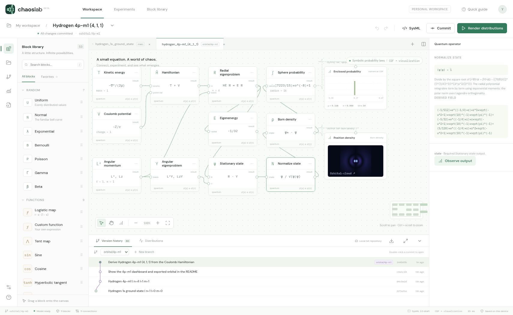

# Hydrogen orbital library

Open **Version history** in Chaos Lab to explore the 20 hydrogen designs in this repository. The original 1s example is on `main`. Each of the 19 excited states in [Sebastian Mag’s cross-section diagram](https://github.com/ssebastianmag/hydrogen-wavefunctions/blob/main/figures/hydrogen_probability_densities.png) branches directly from that example. The diagram accompanies [the article](https://ssebastianmag.medium.com/computational-physics-with-python-hydrogen-wavefunctions-electron-density-plots-8fede44b7b12).

## Hydrogen 4p (n = 4, ℓ = 1, m = 1)

The connected Hamiltonian and eigenstate solvers give $E=-1/32$ Hartree for this state.



Radial nodes: 2. Polar nodes: 0. Plot half-width: 32 Bohr radii.


[View the atlas of all 19 excited states](atlas.png)

## Open the Git dashboard

With Git and Python 3.9 or newer installed:

```sh
git clone https://github.com/wa200508/hydrogen_wavefunction.git
cd hydrogen_wavefunction
python studio.py
```

On Windows you can use `py studio.py`. On Linux you can use `python3 studio.py`. The first launch downloads the pinned Chaos Lab browser build. Double-click a commit to open it in a tab. Open another and use **Split view** to compare them. **Orbital cloud ↗** opens the spatial plots. The launcher reads the Git objects from your clone, including origin branches. For an existing clone, update the checked-out branch with `git pull --ff-only`, fetch the other branches with `git fetch origin`, and restart the launcher. Double-click the latest commit for the design you want to explore.

To compare states with the same radial law, open `orbital/2p-m0` and `orbital/2p-m1`. At the same radius their enclosed-probability probes agree. The first slice is dark on the equatorial plane, while the second is dark along the polar axis.

**Commit** saves to the dashboard’s browser-local copy of the Git repository. **Export → Git repository** includes those commits for use with command-line Git. To publish a new design, extract the archive, add this repository as a remote, and push your design branch. The launcher binds to localhost and reads the on-disk clone.

## Branches and conventions

Branch names encode `(n, ℓ, m)`. For example, `orbital/3d-m1` is `(3,2,1)`. Each snapshot includes the editable graph, its compiled symbolic representation, and its SysML text. Each excited-state branch also contains a reference cross-section.

## How the graph derives this orbital

1. **Kinetic energy** and **Coulomb potential** supply the relative-coordinate operators in atomic units. Their wires feed **Hamiltonian**, which constructs $H=-\nabla^2/(2\mu)-Z/r$. The default is a fixed proton, $Z=\mu=1$.
2. **Angular momentum** selects the joint eigenvalues of $L^2$ and $L_z$. **Radial eigenproblem** uses that angular eigenvalue in the centrifugal term. Regularity at the origin, decay at infinity, and radial-series termination give the polynomial and energy. **Angular eigenproblem** constructs the polar polynomial by Rodrigues differentiation and includes the phase $e^{im\phi}$.
3. **Stationary state** multiplies the separated basis functions. **Normalize state** computes their norm with the spherical volume measure. **Born density** takes the squared modulus of the normalized state. **Sphere probability** integrates that density to the probe radius.
4. Select a block to inspect its equation and derivation. Change **Nuclear charge** from 1 to 2. The energy becomes four times more negative and the orbital contracts by a factor of two. The plot rescales with the orbital, so use its Bohr-radius scale bar to see the change.

The central slice evaluates the final density in the x–z plane. Projected detections sample the final density on a finite radial and angular grid with the spherical volume factor. Coordinates use Bohr radii and energy uses Hartree.

The branch stores the operator graph in `model.json`, its derived fields and scalar laws in `model.symbolic.json`, and the block connections in `model.sysml`. With SymPy installed, run `python tools/verify_state.py` in a checkout of this branch to check the eigenvalue equations, normalization, radial reference solution and sphere integral.


| n | ℓ | m | Design branch |
|---|---|---|---|
|1|0|0|[main](https://github.com/wa200508/hydrogen_wavefunction/tree/main)|
|2|0|0|[orbital/2s-m0](https://github.com/wa200508/hydrogen_wavefunction/tree/orbital/2s-m0)|
|2|1|0|[orbital/2p-m0](https://github.com/wa200508/hydrogen_wavefunction/tree/orbital/2p-m0)|
|2|1|1|[orbital/2p-m1](https://github.com/wa200508/hydrogen_wavefunction/tree/orbital/2p-m1)|
|3|0|0|[orbital/3s-m0](https://github.com/wa200508/hydrogen_wavefunction/tree/orbital/3s-m0)|
|3|1|0|[orbital/3p-m0](https://github.com/wa200508/hydrogen_wavefunction/tree/orbital/3p-m0)|
|3|1|1|[orbital/3p-m1](https://github.com/wa200508/hydrogen_wavefunction/tree/orbital/3p-m1)|
|3|2|0|[orbital/3d-m0](https://github.com/wa200508/hydrogen_wavefunction/tree/orbital/3d-m0)|
|3|2|1|[orbital/3d-m1](https://github.com/wa200508/hydrogen_wavefunction/tree/orbital/3d-m1)|
|3|2|2|[orbital/3d-m2](https://github.com/wa200508/hydrogen_wavefunction/tree/orbital/3d-m2)|
|4|0|0|[orbital/4s-m0](https://github.com/wa200508/hydrogen_wavefunction/tree/orbital/4s-m0)|
|4|1|0|[orbital/4p-m0](https://github.com/wa200508/hydrogen_wavefunction/tree/orbital/4p-m0)|
|4|1|1|[orbital/4p-m1](https://github.com/wa200508/hydrogen_wavefunction/tree/orbital/4p-m1)|
|4|2|0|[orbital/4d-m0](https://github.com/wa200508/hydrogen_wavefunction/tree/orbital/4d-m0)|
|4|2|1|[orbital/4d-m1](https://github.com/wa200508/hydrogen_wavefunction/tree/orbital/4d-m1)|
|4|2|2|[orbital/4d-m2](https://github.com/wa200508/hydrogen_wavefunction/tree/orbital/4d-m2)|
|4|3|0|[orbital/4f-m0](https://github.com/wa200508/hydrogen_wavefunction/tree/orbital/4f-m0)|
|4|3|1|[orbital/4f-m1](https://github.com/wa200508/hydrogen_wavefunction/tree/orbital/4f-m1)|
|4|3|2|[orbital/4f-m2](https://github.com/wa200508/hydrogen_wavefunction/tree/orbital/4f-m2)|
|4|3|3|[orbital/4f-m3](https://github.com/wa200508/hydrogen_wavefunction/tree/orbital/4f-m3)|
