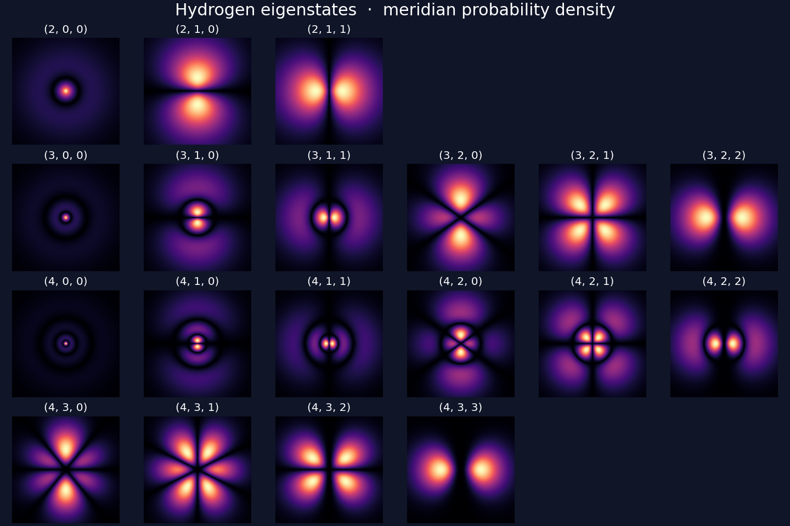
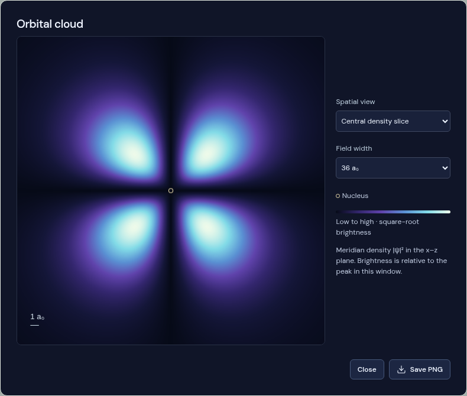
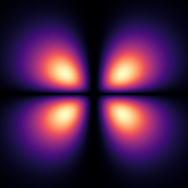

# Hydrogen orbital library

Open **Version history** in Chaos Lab to explore the 20 hydrogen designs in this repository. The original 1s example is on `main`. Each of the 19 excited states in [Sebastian Mag’s cross-section diagram](https://github.com/ssebastianmag/hydrogen-wavefunctions/blob/main/figures/hydrogen_probability_densities.png) branches directly from that example. The diagram accompanies [the article](https://ssebastianmag.medium.com/computational-physics-with-python-hydrogen-wavefunctions-electron-density-plots-8fede44b7b12).



## Open the Git dashboard

With Git and Python 3.9 or newer installed:

```sh
git clone https://github.com/wa200508/hydrogen_wavefunction.git
cd hydrogen_wavefunction
python studio.py
```

On Windows you can use `py studio.py`. On Linux you can use `python3 studio.py`. The first launch downloads the pinned Chaos Lab browser build. Double-click a commit to open it in a tab. Open another and use **Split view** to compare them. **Orbital cloud ↗** opens the spatial plots. The launcher reads the Git objects from your clone, including origin branches. Run `git fetch origin` and restart the launcher to load new remote branches.

The dashboard shows four lobes separated by nodes for the (3, 2, 1) meridian slice.



To compare states with the same radial law, open `orbital/2p-m0` and `orbital/2p-m1`. At the same radius their enclosed-probability probes agree. The first slice is dark on the equatorial plane, while the second is dark along the polar axis.

**Commit** saves to the dashboard’s browser-local copy of the Git repository. **Export → Git repository** includes those commits for use with command-line Git. To publish a new design, extract the archive, add this repository as a remote, and push your design branch. The launcher binds to localhost and reads the on-disk clone.

## Branches and conventions

Branch names encode `(n, ℓ, m)`. For example, `orbital/3d-m1` is `(3,2,1)`. Each snapshot includes the editable graph, its compiled symbolic representation, and its SysML text. Each excited-state branch also contains a reference cross-section.

Coordinates are in Bohr radii. These are normalized fixed-proton, nonrelativistic spatial eigenstates in the complex spherical-harmonic basis. For a fixed m the azimuthal phase is exp(i m φ), so probability density is axially symmetric. The graph evaluates the real meridian amplitude at φ = 0 using radius r and u = cos θ. Its square is probability per unit volume. The sphere probe integrates the radial Born law. The field tap sweeps the same amplitude expression for the x–z slice and its projected detections. Detections are drawn for display from a numerical grid of the final density including the r² volume factor. Brightness and plotting windows are scaled per orbital.

| n | ℓ | m | Design branch |
|---|---|---|---|
|1|0|0|[main](https://github.com/wa200508/hydrogen_wavefunction/tree/main)|
|2|0|0|[orbital/2s-m0](https://github.com/wa200508/hydrogen_wavefunction/tree/orbital/2s-m0)|
|2|1|0|[orbital/2p-m0](https://github.com/wa200508/hydrogen_wavefunction/tree/orbital/2p-m0)|
|2|1|1|[orbital/2p-m1](https://github.com/wa200508/hydrogen_wavefunction/tree/orbital/2p-m1)|
|3|0|0|[orbital/3s-m0](https://github.com/wa200508/hydrogen_wavefunction/tree/orbital/3s-m0)|
|3|1|0|[orbital/3p-m0](https://github.com/wa200508/hydrogen_wavefunction/tree/orbital/3p-m0)|
|3|1|1|[orbital/3p-m1](https://github.com/wa200508/hydrogen_wavefunction/tree/orbital/3p-m1)|
|3|2|0|[orbital/3d-m0](https://github.com/wa200508/hydrogen_wavefunction/tree/orbital/3d-m0)|
|3|2|1|[orbital/3d-m1](https://github.com/wa200508/hydrogen_wavefunction/tree/orbital/3d-m1)|
|3|2|2|[orbital/3d-m2](https://github.com/wa200508/hydrogen_wavefunction/tree/orbital/3d-m2)|
|4|0|0|[orbital/4s-m0](https://github.com/wa200508/hydrogen_wavefunction/tree/orbital/4s-m0)|
|4|1|0|[orbital/4p-m0](https://github.com/wa200508/hydrogen_wavefunction/tree/orbital/4p-m0)|
|4|1|1|[orbital/4p-m1](https://github.com/wa200508/hydrogen_wavefunction/tree/orbital/4p-m1)|
|4|2|0|[orbital/4d-m0](https://github.com/wa200508/hydrogen_wavefunction/tree/orbital/4d-m0)|
|4|2|1|[orbital/4d-m1](https://github.com/wa200508/hydrogen_wavefunction/tree/orbital/4d-m1)|
|4|2|2|[orbital/4d-m2](https://github.com/wa200508/hydrogen_wavefunction/tree/orbital/4d-m2)|
|4|3|0|[orbital/4f-m0](https://github.com/wa200508/hydrogen_wavefunction/tree/orbital/4f-m0)|
|4|3|1|[orbital/4f-m1](https://github.com/wa200508/hydrogen_wavefunction/tree/orbital/4f-m1)|
|4|3|2|[orbital/4f-m2](https://github.com/wa200508/hydrogen_wavefunction/tree/orbital/4f-m2)|
|4|3|3|[orbital/4f-m3](https://github.com/wa200508/hydrogen_wavefunction/tree/orbital/4f-m3)|

## Current design (4, 3, 2)



Radial nodes: 0. Polar nodes: 1. Plot half-width: 32 Bohr radii.
